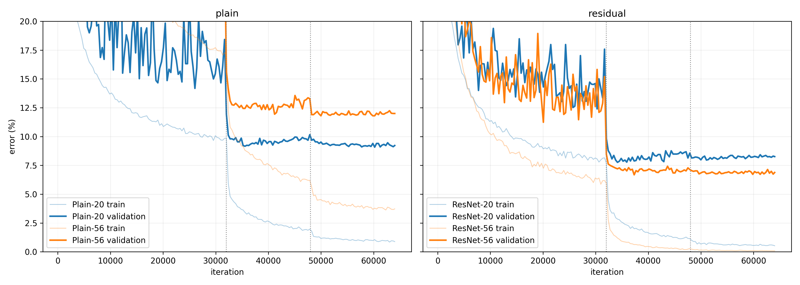
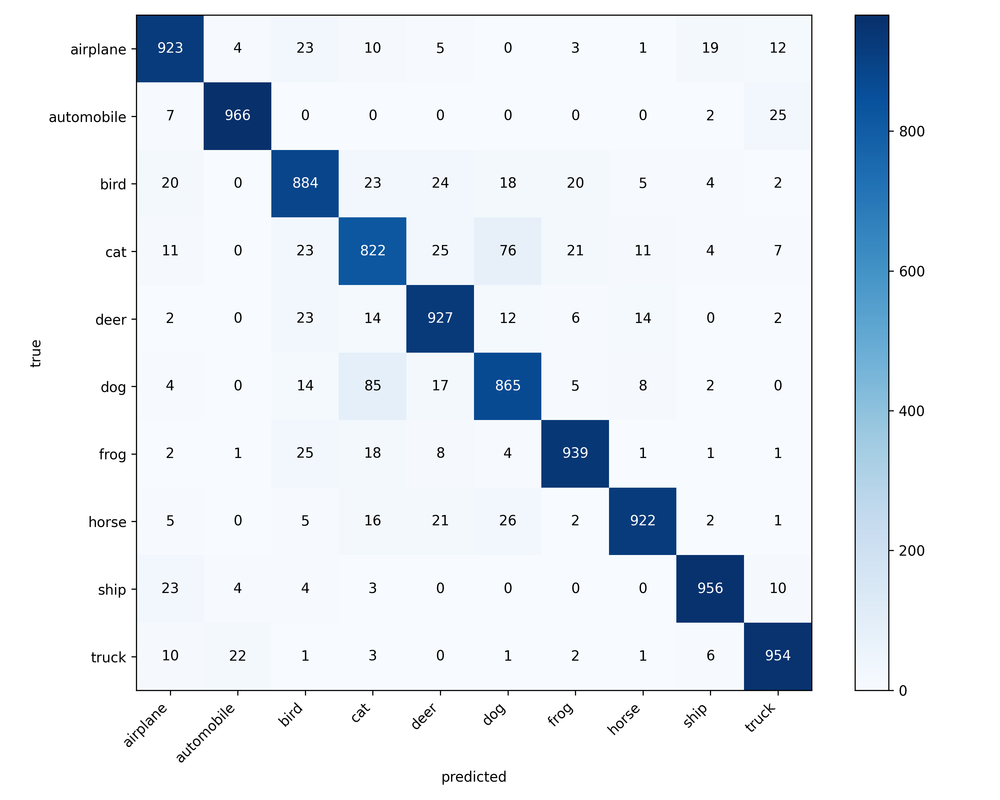
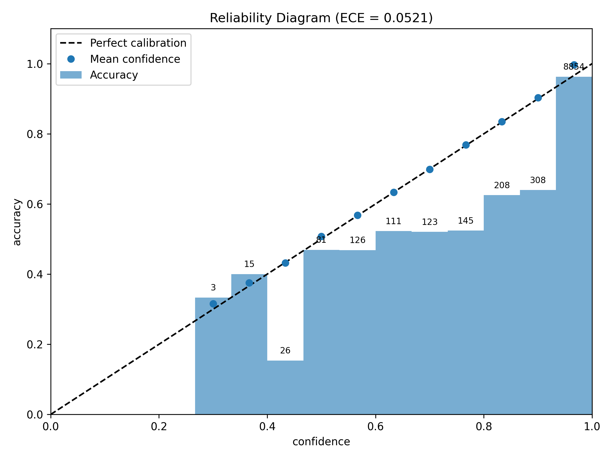
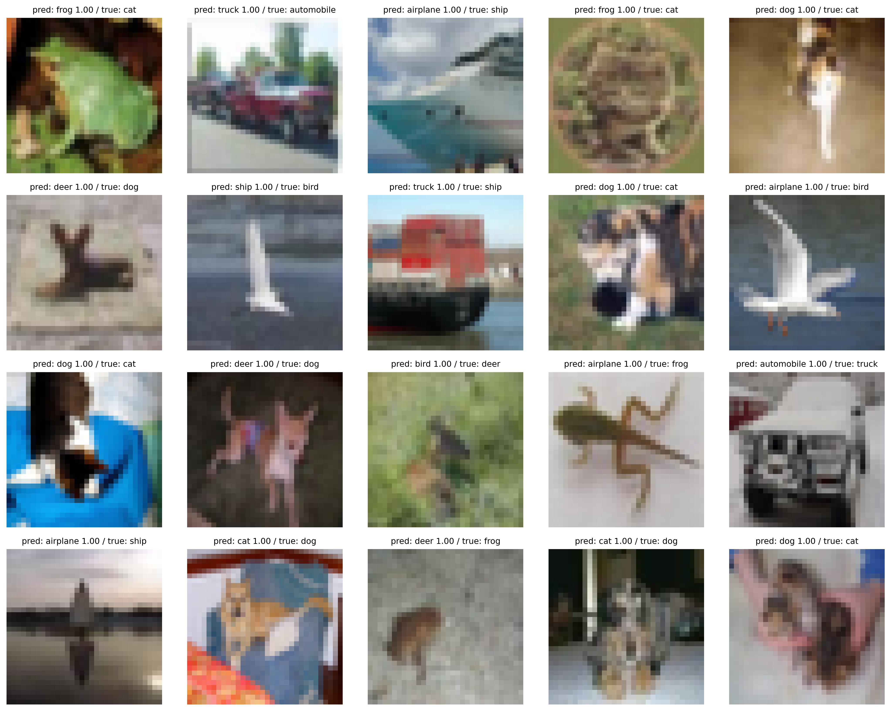

# ResNet-20 on CIFAR-10: reproduced and served
**Full guide:** every tensor shape, formula and gradient, end to end: [docs/guide/resnet20_guide.pdf](docs/guide/resnet20_guide.pdf)

This project focused on recreating the main architecture of ResNet-20 on the CIFAR-10 dataset, from He et al. 2015 paper called "*Deep Residual Learning for Image Recognition*".

 This was entirely done in PyTorch from scratch meaning hand-written PyTorch, with no model libraries and no pretrained weights; the blocks, the initialisation, the augmentation, the schedule, the training loop and every metric are written by hand.

Achieved 8.42% test error compared to that of the original paper 8.75% test error, this was also made to be a deployed application using both Docker and FastAPI Service so anyone can use this model and test it themselves.

Beyond reproduction, the project investigates the impact of residual connections through a depth ablation comparing plain and residual ResNet-20 and ResNet-56, and includes an evaluation report covering classification errors, confusion patterns, calibration, and confident misclassifications.

Paper link : https://arxiv.org/abs/1512.03385


## Result

| Model | Test error (this repo) | Test error (paper) |
|---|---:|---:|
| ResNet-20 | 8.42% | 8.75% |


One honest caveat is that this number should never be seen as "beating" the paper because both the reported 8.42% and the paper’s 8.75% ResNet-20 test errors come from single runs, and the paper’s five-run results for ResNet-110 show a standard deviation of approximately 0.16 percentage points, illustrating the impact of run-to-run variation. The 0.33-percentage-point difference is therefore best treated as a result that matches the paper’s reported performance, rather than evidence of superiority


## Recipe

| Setting | Paper | This repo |
|---|---|---|
| Input normalization |per-pixel mean subtracted |/255, then subtract the per-pixel mean of the training images |
| Batch size |128 |128 |
| Initial learning rate |0.1 | 0.1|
| Learning-rate drops |÷10 at 32k and 48k iterations  | ÷10 at 32k and 48k iterations|
| Total iterations |64k |64k |
| Momentum |0.9 |0.9 |
| Weight decay |1e-4 |1e-4 |
| Weight initialization |He (Kaiming) normal, std = √(2 / fan_in) |same for convs; the final linear layer uses PyTorch’s default |
| Augmentation |pad 4, random 32x32 crop, horizontal flip |same, applied to the raw uint8 image, training only |
| Shortcut type |identity, zero-padded channels when size differs |same, with stride-2 subsampling on the shortcut |
| Training data |45k/5k split to choose settings, final model on all 50k |same: 45k/5k with seed 0 for development, final on 50k
| Test evaluation |single view of the original 32×32 image|same |


## Depth ablation

Setup: the four nets, plain-20/56 and res-20/56 were all trained using the same exact recipe on the 45k split, seed 0.
Evaluation happened once on the test set (10k)


| Run | Depth | Type | Train error | Validation error | Test error |
|---|---:|---|---:|---:|---:|
| ResNet-20 | 20 | residual | 0.52% | 8.26% | 9.29% |
| plain-20 | 20 | plain | 0.88% | 9.22% | 9.77% |
| ResNet-56 | 56 | residual | 0.08% | 6.88% | 7.92% |
| plain-56 | 56 | plain | 3.72% | 12.00% | 12.94% |





**Findings:**

- Increasing the depth of plain networks from 20 to 56 layers worsened test error from **9.77% to 12.94%**, while increasing the depth of residual networks improved test error from **9.29% to 7.92%**.
- The degradation of Plain-56 is not explained by overfitting alone: its training error also increased from **0.88% to 3.72%**, indicating an optimization degradation as the network became deeper.
- The ResNet-20 ablation run achieved **9.29% test error** because it was trained on only 45,000 images, reserving 5,000 for validation, whereas the headline **8.42%** result used the full 50,000-image training set.

## Evaluation


All results below are for the final ResNet-20, trained on the full 50,000-image training set and evaluated on the 10,000-image CIFAR-10 test set.


| class | precision | recall | F1 |
|---|---|---|---|
| airplane | 0.917 | 0.923 | 0.920 |
| automobile | 0.969 | 0.966 | 0.967 |
| bird | 0.882 | 0.884 | 0.883 |
| cat | 0.827 | 0.822 | 0.824 |
| deer | 0.903 | 0.927 | 0.915 |
| dog | 0.863 | 0.865 | 0.864 |
| frog | 0.941 | 0.939 | 0.940 |
| horse | 0.957 | 0.922 | 0.939 |
| ship | 0.960 | 0.956 | 0.958 |
| truck | 0.941 | 0.954 | 0.947 |

- Accuracy: 0.9158
- Mean F1: 0.9158
- ECE (15 bins): 0.0521



The main weakness is distinguishing cats from dogs, with 85 dogs misclassified as cats and 76 cats misclassified as dogs; cat is the weakest class, with a recall of 82.2%.




The model has an Expected Calibration Error (ECE) of 5.2%, with a mean confidence of 96.8% compared to an accuracy of 91.6%, indicating that it is overconfident in its predictions.

A total of 8,854 out of 10,000 predictions fall into the highest-confidence bin, while the low-confidence bins contain too few predictions to reveal a clear pattern.




Six of the 20 most confident incorrect predictions involve cats and dogs being misclassified as one another. The first example is labelled as a cat but looks like a frog, suggesting that it may be a labelling error in the dataset rather than a mistake made by the model.

## Serving

| Endpoint | Input | Output |
|---|---|---|
| `GET /health` | – | `{"status": "ok"}` |
| `POST /predict` | an image file, as multipart form field `file` | the top 3 classes with probabilities |

Example response for `samples/test0.png`:

```json
{
  "top3": [
    {"class": "cat", "prob": 0.9999998807907104},
    {"class": "dog", "prob": 1.553191140146737e-07},
    {"class": "frog", "prob": 2.5087427690806408e-09}
  ]
}
```

Probabilities this close to 1 are typical for this model; see the calibration section.

- The API accepts images of any size, converts them to RGB, and resizes them to 32×32 pixels. Large photos lose much of their original detail during resizing, so predictions on them are less reliable than on images similar to those in CIFAR-10.

- If the uploaded file is not a valid image, the API returns HTTP 400 with a clear error message instead of an internal server error.

- The API uses the same preprocess function from data.py as the training pipeline. The model is loaded once at startup and set to evaluation mode, keeping inference consistent with the preprocessing and model behaviour used during training.


| Measurement | p50 | p95 |
|---|---:|---:|
| Native on Windows (uvicorn, CPU) | 3.9 ms | 7.0 ms |
| Docker Desktop on Windows (CPU) | 48 ms | 50 ms |
| Model forward pass alone | 1.4 ms | – |


*Measurements were taken over 100 sequential requests from a single client reusing its connection, after 10 warm-up requests, using a 32×32 PNG.*

The extra latency in Docker Desktop is in the request path into the container, not the model; its exact source wasn’t measured.

## Run it

### Serve with Docker (CPU)

```
docker build -t resnet-cifar10 .
docker run --rm -p 8000:8000 resnet-cifar10
curl -F "file=@samples/test0.png" http://127.0.0.1:8000/predict
```

An upload form is also available at `http://127.0.0.1:8000/docs`.

### Reproduce training and evaluation (GPU)

Install PyTorch with CUDA from pytorch.org, then:

```
pip install torchvision numpy matplotlib
python -m scripts.make_mean_50k
python -m scripts.train_resnet --name final_res20 --full
python -m scripts.eval_test --checkpoint artifacts/checkpoints/final_res20.pt --mean artifacts/pixel_mean_50k.npy --name final_res20
python -m scripts.make_report --name final_res20
```

Training takes about 36 minutes on an RTX 3050.
The ablation runs use `--plain` and `--n 9` on the 45k split; see `scripts/train_resnet.py`.

### Tests

```
pip install torch==2.14.1 --index-url https://download.pytorch.org/whl/cpu
pip install -r requirements.txt pytest httpx
python -m pytest
```
## Layout

| Path | Contents |
|---|---|
| `cifar_resnet/` | is the core project; it contains the data, model, training and evaluation code |
| `scripts/` | contains the main entry points for training (`train_resnet.py`), test evaluation (`eval_test.py`), report generation (`make_report.py`) and ablation (`make_ablation.py`), along with the mean files and `check_*.py` development checks |
| `service/` | has the FastAPI app and its code |
| `tests/` | has scripts used to test the service: valid image prediction, invalid file rejection and different image sizes |
| `model/` | has the final ResNet-20 weights and the 50k per-pixel mean used by the service |
| `docs/figures/` | contains the resulting figures from testing the model and evaluating its metrics |
| `samples/` | contains the test image used by the automated tests and the README example |

## Limitations


- **Single seed:** All results come from one run using seed 0. Differences of a few tenths of a percentage point may be due to variation between runs rather than a real improvement.
- **Ablation split:** The four ablation runs used 45k training images instead of the full 50k. Their test error rates are about one percentage point higher than the main result, so the two should not be compared directly.
- **Container latency:** Docker Desktop on Windows adds around 44 ms of latency compared with native execution. The cause was not investigated further.
- **Use of AI assistance:** The plotting code was generated with the help of an AI assistant. The rest of the implementation, including the model, initialisation, augmentation, learning-rate schedule, training loop, metrics and prediction service, was written by hand.
   The guide in docs/guide/ was drafted with an AI assistant from this repository's code and artifacts, and checked numerically against the trained model.
